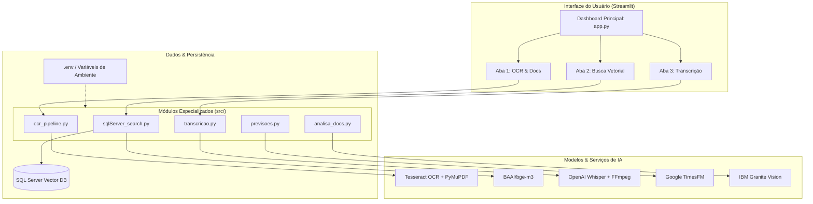

# 🚀 AI Multi-App Platform

<div align="center">

[](https://www.python.org/)
[](https://streamlit.io/)
[](https://pytorch.org/)
[](https://huggingface.co/)
[](https://www.docker.com/)
[](LICENSE)

**Plataforma modular de Inteligência Artificial aplicada para Processamento de Documentos (OCR/VLM), Busca Vetorial Semântica (RAG), Transcrição de Áudio (Whisper) e Previsão de Séries Temporais (TimesFM).**

[Visão Geral](#-visão-geral) •
[Funcionalidades](#-funcionalidades) •
[Arquitetura](#-arquitetura) •
[Pré-requisitos](#-pré-requisitos) •
[Como Executar](#-como-executar) •
[Segurança](#-segurança-e-boas-práticas) •
[Estrutura](#-estrutura-do-projeto)

</div>

---

## 📌 Visão Geral

O **AI Multi-App** é um ecossistema projetado para demonstrar a aplicação prática de modelos de inteligência artificial de última geração (SOTA) em fluxos de trabalho empresariais. 

A plataforma consolida em uma interface intuitiva e reativa desenvolvida com **Streamlit**:
1. **Inteligência em Documentos**: Extração de texto de PDFs e imagens com anotação visual e VLM (Vision-Language Models).
2. **Busca Semântica & Recuperação de Informação**: Busca vetorial híbrida em banco de dados relacional (SQL Server) potencializada por embeddings densos.
3. **Processamento Multimídia**: Conversão de áudio para texto via OpenAI Whisper com suporte a pipelines de áudio com FFmpeg.
4. **Ciência de Dados & Forecasting**: Modelos de fundação para séries temporais prevendo demandas com intervalos de confiança e detecção automática de anomalias.

---

## ✨ Funcionalidades

### 1. 📄 Análise de Documentos e OCR Inteligente
- Suporte a arquivos **PDF, PNG, JPG e JPEG**.
- Extração de texto combinando **PyMuPDF (Fitz)** para PDFs nativos e **Tesseract OCR** (com idioma português pré-configurado) para documentos escaneados.
- Realce e anotação visual com coordenadas das palavras detectadas na imagem original.
- Cópia do texto extraído para a área de transferência com um clique.

### 2. 🔍 Busca Vetorial Semântica (SQL Server Vector Store)
- Geração de embeddings com o modelo **`BAAI/bge-m3`** (vetores de 1024 dimensões).
- Execução de consultas por proximidade semântica utilizando cálculo nativo de cosseno (`VECTOR_DISTANCE('cosine', ...)`).
- Visualização de resultados ordenada por similaridade vetorial com exibição de resumos e trechos do documento original.

### 3. 🎙️ Transcrição de Áudio Automatizada
- Transcrição precisa de arquivos de áudio utilizando o modelo **OpenAI Whisper**.
- Pré-processamento e normalização de áudio em tempo de execução via **FFmpeg**.
- Detecção e suporte a múltiplos idiomas e sotaques.

### 4. 📈 Previsão de Séries Temporais (Google TimesFM)
- Previsão de demanda utilizando o modelo de fundação **`google/timesfm-2.5-200m-pytorch`**.
- Incorporação de covariáveis temporais externas (marcação de finais de semana e feriados nacionais).
- Geração de intervalos de confiança calibrados (quantis 10% a 90%).
- Detecção automática de **outliers / anomalias** em dados históricos e visualização interativa com **Plotly**.

### 5. 👁️ Análise Visual de Documentos (VLM - Granite Vision)
- Processamento multimodal via modelo **`ibm-granite/granite-vision-3.3-2b`**.
- Visual Question Answering (VQA) para leitura e interpretação contextual de formulários, documentos de identificação (CNH/RG) e certidões.

---

## 🏛️ Arquitetura do Sistema



---

## 📋 Pré-requisitos

Para executar a aplicação localmente, certifique-se de ter instalado no sistema:

1. **Python 3.11+**
2. **Microsoft ODBC Driver 17 for SQL Server** (para conexão com a base vetorial)
3. **Tesseract OCR**:
   - Windows: [Instalador Tesseract OCR](https://github.com/UB-Mannheim/tesseract/wiki) (adicione o idioma Português `por.traineddata`).
   - Linux: `sudo apt-get install tesseract-ocr tesseract-ocr-por`
4. **FFmpeg** (necessário para o Whisper processar mídias de áudio):
   - Windows:
     ```powershell
     winget install Gyan.FFmpeg
     ```
   - Linux (Debian/Ubuntu):
     ```bash
     sudo apt-get update && sudo apt-get install -y ffmpeg
     ```
   - macOS:
     ```bash
     brew install ffmpeg
     ```

---

## 🛠️ Como Executar

### 1. Clonar o Repositório
```bash
git clone https://github.com/seu-usuario/multi-app.git
cd multi-app
```

### 2. Criar e Ativar o Ambiente Virtual
```bash
# Windows
python -m venv .venv
.venv\Scripts\activate

# Linux / macOS
python3 -m venv .venv
source .venv/bin/activate
```

### 3. Instalar Dependências
```bash
pip install --upgrade pip
pip install -r requirements.txt
```

### 4. Configurar as Variáveis de Ambiente
Copie o arquivo de exemplo `.env.example` para `.env` e configure suas credenciais:
```bash
cp .env.example .env
```

Edite o arquivo `.env`:
```env
DRIVER={ODBC Driver 17 for SQL Server}
SERVER=localhost
DATABASE=IA_DATABASE
UID=sa
PWD=sua_senha_segura
Encrypt=yes
TrustServerCertificate=yes
```

### 5. Iniciar a Aplicação
```bash
streamlit run app.py
```
Acesse o navegador no endereço: `http://localhost:8501`.

---

## 🐳 Executando com Docker

O projeto inclui um `Dockerfile` completo baseado no Debian Bullseye com todas as dependências pré-instaladas (ODBC Driver 17, Tesseract OCR com suporte a português, FFmpeg e PyTorch):

```bash
# 1. Build da imagem
docker build -t multi-app .

# 2. Executar o container
docker run -p 5002:5002 --env-file .env multi-app
```
Acesse a aplicação via: `http://localhost:5002/multi-app`.

---

## 🔒 Segurança e Boas Práticas

Este repositório foi sanitizado seguindo rigorosas práticas de segurança:

- **Zero Hardcoded Secrets**: Nenhuma senha, token ou credencial corporativa está fixada no código.
- **Isolamento de Ambiente**: As credenciais são carregadas via `python-dotenv` a partir de um arquivo `.env` estritamente ignorado no `.gitignore`.
- **Tratamento de Colisão de Ambiente**: O módulo `sqlServer_search.py` trata a sobrescrita comum da variável de sistema `PWD` (diretório atual do SO) garantindo autenticação correta.
- **Prevenção de Fuga de Dados**: `.dockerignore` e `.gitignore` configurados para barrar caches (`__pycache__`), logs, imagens geradas e arquivos de backup.
- **Templates Seguros**: O repositório disponibiliza apenas `.env.example` com placeholders neutros e documentados.

---

## 📂 Estrutura do Projeto

```
multi-app/
│
├── assets/                    # Recursos de apoio, imagens e dados demonstrativos
│   ├── csv/                   # Datasets para testes de previsão
│   └── images/                # Imagens de amostra para testes de OCR e VLM
│
├── src/                       # Código-fonte modular da aplicação
│   ├── analisa_docs.py        # Módulo VLM com IBM Granite Vision
│   ├── ocr_pipeline.py        # Pipeline de extração OCR com Tesseract e PyMuPDF
│   ├── previsoes.py           # Séries temporais e anomalias com Google TimesFM
│   ├── sqlServer_search.py    # Busca vetorial e conexão segura com SQL Server
│   └── transcricao.py         # Módulo de transcrição de áudio com OpenAI Whisper
│
├── .dockerignore              # Regras de exclusão do build Docker
├── .env.example               # Template público de variáveis de ambiente
├── .gitignore                 # Exclusão segura de segredos, logs e binários
├── app.py                     # Ponto de entrada e interface Streamlit
├── Dockerfile                 # Configuração do container Docker
├── README.md                  # Documentação completa do projeto
├── requirements.txt           # Especificação das dependências Python
└── SPEC-public-repo-readiness.md # Especificação técnica do projeto
```

---

## 👨‍💻 Autor

Desenvolvido por **Matheus Santos** como projeto de portfólio em Engenharia de Inteligência Artificial e Aplicações com Python.

- **LinkedIn**: [Matheus Santos](https://www.linkedin.com/in/)
- **Email**: [matheus3881.ms@gmail.com](mailto:matheus3881.ms@gmail.com)

---

## 📄 Licença

Este projeto está sob a licença [MIT](LICENSE).
